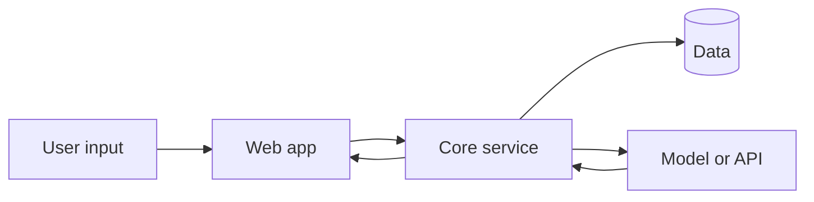

# Architecture Strategy

Use when planning or explaining technical credibility. Do not read it merely to justify refactoring a working build.

## Design standard

The best hackathon architecture is explainable, debuggable, and sufficient for the Golden Path. It does not need enterprise scale unless scale is judged.

Create `ARCHITECTURE.md` with:

- frontend, backend, data store, model/algorithm, infrastructure, and external integrations;
- the end-to-end data flow for the Golden Path;
- where computation, validation, caching, and fallback occur;
- one or two notable technical challenges solved;
- REAL / SIMULATED / MOCKED / FALLBACK classifications;
- security and architectural shortcuts;
- scale or production limits;
- a compact diagram that can be shown to judges.

## Diagram rule

Use a diagram only when it clarifies components or flow. Keep it to the primary experience and avoid boxes for technologies that do not affect the explanation. A judge should trace input to result in under 20 seconds.

Example structure:

Replace labels with domain terms; do not show this generic diagram in a submission.

## Credibility test

For every box, be ready to answer:

- What did the team build during the event?
- Why is this component necessary?
- What happens to data here?
- What is genuinely difficult or novel?
- What is cached, mocked, or simplified?
- What fails if this dependency is unavailable?
- How would this change for production?

Keep commits and decision notes that substantiate event-time work, particularly when rules restrict pre-existing code.

## Avoid architecture theater

Do not add microservices, queues, Kubernetes, event buses, vector databases, agents, or diagrams merely to look technical. Technical credibility comes from a real contribution, clear tradeoffs, evidence, and a working demo.
